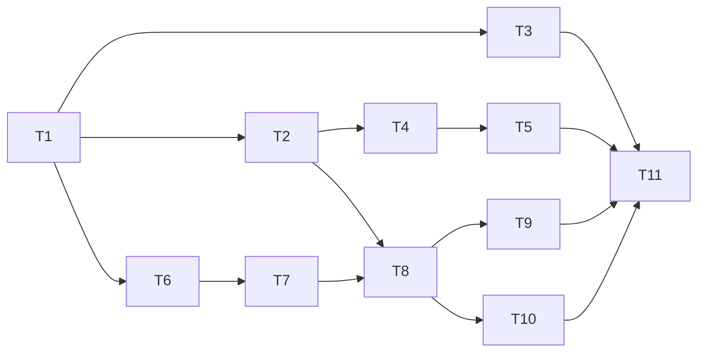

# Dispositivi e regolazione: piano dei ticket

Fonte: [specifica GitHub #8](https://github.com/LucaPalumbo/HackBrew/issues/8). Stato: **piano approvato, pubblicato e verificato**. T1–T11 identificano le porzioni del piano; le issue operative sono #9–#19, collegate sotto.

Ogni porzione include schema/persistenza, API o contratto esterno, interfaccia osservabile e test pubblici necessari al comportamento consegnato. Non serve un refactoring preliminare separato: distinguere le pillole e allargare il contratto delle misure sono parte del primo percorso utilizzabile. Il codice rimane verificabile tra gli incrementi; regolazione e ON non vengono abilitati prima del percorso completo di T8.

## Ticket pubblicati

1. **T1 — [#9: Registrare pillole e distinguere tutte le letture per sorgente](https://github.com/LucaPalumbo/HackBrew/issues/9).** Nessun blocco. Consegna registro web, diagnostica live per pillola, tutte le misure conservate e scelta della pillola nel monitoraggio esistente. Include la procedura deliberata di reset della vecchia versione.
2. **T2 — [#10: Monitorare fermentazioni parallele con card e dettaglio](https://github.com/LucaPalumbo/HackBrew/issues/10).** Bloccato da #9. Consegna più cicli in solo monitoraggio, esclusività della pillola, card, ricerca, dettaglio e termine indipendente.
3. **T3 — [#11: Collegare tutte le pillole con un bridge sincronizzato automaticamente](https://github.com/LucaPalumbo/HackBrew/issues/11).** Bloccato da #9. Consegna il vero bridge multi-pillola con registro acquisito dal sito e messaggi identificati, verificato contro HackBrew senza hardware.
4. **T4 — [#12: Visualizzare tutte le misure in un grafico unico a linee](https://github.com/LucaPalumbo/HackBrew/issues/12).** Bloccato da #10. Consegna sette serie, legenda, scale corrette e valori accessibili, senza interruzioni temporali.
5. **T5 — [#13: Esplorare intervalli e zoom senza perdere il live](https://github.com/LucaPalumbo/HackBrew/issues/13).** Bloccato da #12. Consegna barra, preset, zoom rotella/selezione mouse/pinch, pan, caricamento completo del periodo e Torna al live.
6. **T6 — [#14: Registrare dispositivi termici e verificarne lo stato tramite HTTP](https://github.com/LucaPalumbo/HackBrew/issues/14).** Bloccato da #9. Consegna registro con capacità, verifica del collegamento, stato confermato e simulatori del contratto HTTP.
7. **T7 — [#15: Configurare e sincronizzare il timeout globale simmetrico](https://github.com/LucaPalumbo/HackBrew/issues/15).** Bloccato da #14. Consegna pagina Impostazioni, valore iniziale di tre ore, modifica persistita e conferma dell'applicazione sugli attuatori.
8. **T8 — [#16: Regolare il riscaldamento e terminare definitivamente la fermentazione](https://github.com/LucaPalumbo/HackBrew/issues/16).** Bloccato da #10 e #15. Consegna creazione con heater, isteresi, esclusività, timeout sui due lati, conferme, sospensione/ripresa e OFF definitivo con prenotazioni pendenti.
9. **T9 — [#17: Regolare raffreddamento e dispositivi combinati senza sovrapposizioni](https://github.com/LucaPalumbo/HackBrew/issues/17).** Bloccato da #16. Consegna cooler-only, heater+cooler e combinato, con interblocco e spegnimento completo.
10. **T10 — [#18: Modificare fascia termica e consultare lo storico delle impostazioni](https://github.com/LucaPalumbo/HackBrew/issues/18).** Bloccato da #16. Consegna modifiche durante il ciclo, applicazione coerente e cronologia persistita, senza cambiare le assegnazioni.
11. **T11 — [#19: Riprendere monitoraggio e regolazione dopo guasti e riavvii](https://github.com/LucaPalumbo/HackBrew/issues/19).** Bloccato da #11, #13, #17 e #18. Consegna riconciliazione e prova integrata dell'intero sistema durante arresti reali, guasti e ritorno dei servizi.

## Dipendenze

La frontiera iniziale è [#9](https://github.com/LucaPalumbo/HackBrew/issues/9), corrispondente a T1. Dopo T1, T2/T3/T6 possono procedere indipendentemente; il lavoro sui grafici non deve aspettare il bridge o la regolazione, e la regolazione può essere provata con telemetria HTTP senza aspettare il vero bridge. T9 e T10 sono indipendenti dopo T8. I quattro blocchi di T11 servono a verificare le interazioni nell'intero sistema assemblato.

T7 consegna impostazione globale e sincronizzazione, con dispositivi ancora non accesi dalle fermentazioni. T8 abilita la prima regolazione insieme a tutti i controlli essenziali di timeout, OFF, conferme e ripartenza. Nessun ticket rimanda i propri test o garanzie essenziali al solo T11.

## Copertura e pubblicazione

I ticket coprono tutte le **71 user story** della specifica e contengono **102 criteri di accettazione**; l'associazione è conservata nei metadati del piano.

Tutti gli 11 ticket sono stati pubblicati come sub-issue della specifica #8, con etichetta `ready-for-agent` e 14 relazioni native di blocco. I riferimenti provvisori nei corpi pubblicati sono stati sostituiti dai collegamenti alle issue reali. Contenuti, criteri, etichette, gerarchia e dipendenze sono stati verificati attraverso GitHub.

L'utente ha approvato granularità e dipendenze. Corpo, titolo, stato, etichette e commenti della specifica genitore sono rimasti invariati. Le bozze approvate e le copie dei corpi pubblicati sono conservate nel piano; il tracker operativo resta GitHub Issues.
