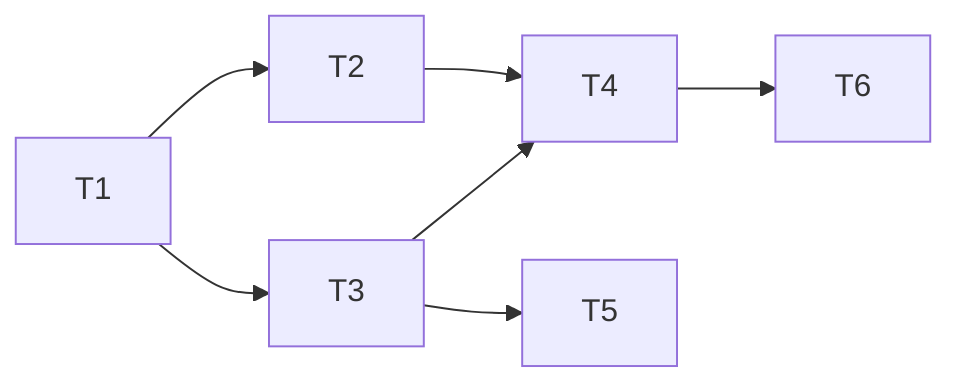

# HackBrew MVP: piano dei ticket

Fonte: [specifica GitHub #1](https://github.com/LucaPalumbo/HackBrew/issues/1). Stato: piano approvato dall'utente, pubblicato e verificato. T1–T6 identificano le porzioni del piano; le issue operative sono #2–#7, collegate sotto.

Ogni ticket realizza e verifica un percorso completo attraverso applicazione, MongoDB e interfaccia. Il primo introduce gli strumenti necessari consegnando già la prima lettura visibile. Non serve un ticket di refactoring preliminare perché il progetto contiene soltanto documentazione.

1. **T1 — [#2: Visualizzare l'ultima lettura in Docker](https://github.com/LucaPalumbo/HackBrew/issues/2).** Nessun blocco. Consegna: invio HTTP, persistenza reale e valori visibili nella dashboard diagnostica.
2. **T2 — [#3: Aggiornare la dashboard in tempo reale e segnalare dati non aggiornati](https://github.com/LucaPalumbo/HackBrew/issues/3).** Bloccato da #2. Consegna: aggiornamenti SSE, freschezza, riconnessione e consultazione da telefono.
3. **T3 — [#4: Avviare e terminare una fermentazione registrandone le letture](https://github.com/LucaPalumbo/HackBrew/issues/4).** Bloccato da #2. Consegna: ciclo manuale con nome, una sola fermentazione attiva e storico persistito.
4. **T4 — [#5: Consultare grafici e storico delle fermentazioni](https://github.com/LucaPalumbo/HackBrew/issues/5).** Bloccato da #3 e #4. Consegna: grafici live dell'attiva e consultazione delle concluse, su computer e telefono.
5. **T5 — [#6: Conservare letture corrette con duplicati e ritardi](https://github.com/LucaPalumbo/HackBrew/issues/6).** Bloccato da #4. Consegna: dati idempotenti, ordinati e attribuiti al corretto intervallo anche tra fermentazioni successive.
6. **T6 — [#7: Riprendere il monitoraggio dopo l'indisponibilità dei servizi](https://github.com/LucaPalumbo/HackBrew/issues/7).** Bloccato da #5. Consegna: errori espliciti e ripresa di dashboard live, fermentazione e storico senza perdita dei dati accettati.

## Revisione completata

L'utente ha approvato granularità e dipendenze. I sei ticket coprono le 48 user story della specifica e contengono complessivamente 61 criteri di accettazione.

## Pubblicazione verificata

Ogni ticket è stato pubblicato con etichetta `ready-for-agent` e collegato alla specifica come sub-issue. Le dipendenze sono relazioni native di GitHub. Corpi, criteri, etichette e collegamenti sono stati verificati dopo la pubblicazione.

Il contenuto, il titolo, lo stato e le etichette della specifica genitore sono stati conservati. Le copie approvate e i corpi pubblicati sono conservati insieme ai metadati del piano; il tracker operativo rimane GitHub Issues.

La frontiera iniziale contiene soltanto la issue #2. Per lo stato corrente delle attività e dei blocchi consultare GitHub.
